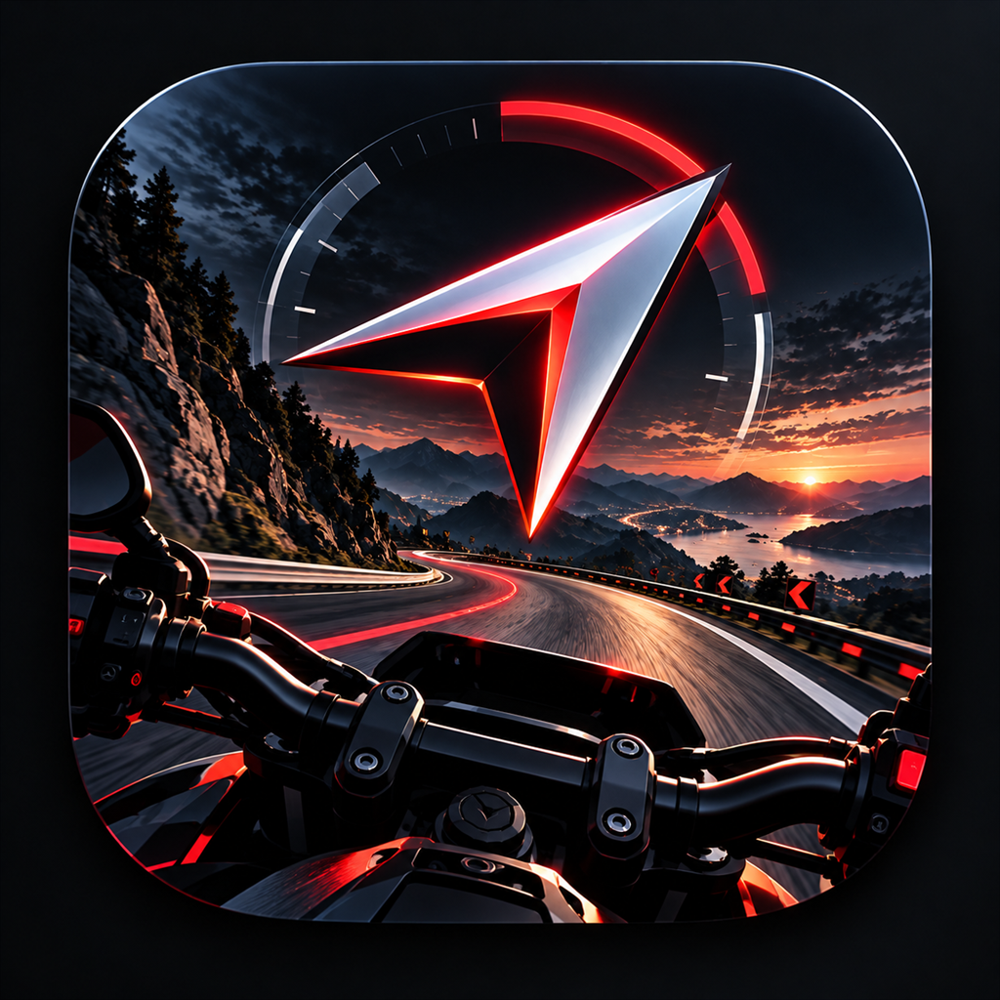

# MotoNav iOS 0.16.0 · Build12

2026-10-31 更新。iPhone 配合微雪 ESP32-S3-Touch-AMOLED-1.75 圆屏使用，最低 iOS 15。使用「导航、轨迹、圆屏、我的」四个栏目，支持系统深浅色；本版更换为红白导航箭头与摩托车山路图标。



## UI 来源与致谢

本版 UI 参考移植并适配自 **[coolcoolmanman（@coolcoolmanman-design）的 MotoNav](https://github.com/coolcoolmanman-design/MotoNav)**，参考版本 **0.15.21-tpms**，固定参考提交为 [c01d6db1a323e91d0b0210b796d9bb6a0cd7bd0f](https://github.com/coolcoolmanman-design/MotoNav/tree/c01d6db1a323e91d0b0210b796d9bb6a0cd7bd0f)。

参考范围包括四栏目结构、语义配色、玻璃导航栏、设备卡与圆屏连接动画、轨迹页面布局。感谢原作者的界面设计与实现；本项目在 iOS 0.16.0 功能基础上进行适配。胎压、音乐封面和参考分支的其他固件扩展不在本次移植范围。图标使用本项目维护者提供的图片。

完整来源与适配范围见 [UI-SOURCE-NOTICE.md](UI-SOURCE-NOTICE.md)。本轮实现与整理由 AI 辅助，沿用仓库的[非商业使用条款](../LICENSE.md)，第三方来源和许可继续保留。

## 本轮主要改动

- **界面与选路**：四栏目、设备卡、连接动画；起终点和最多三个有序途经点，支持调整顺序、搜索加油站、收藏及最近目的地。摩托车规划历史最多保存 20 条，重新使用时重新规划。
- **导航与自行车**：保留摩托车网页路线、驾车及自行车规划、真实/模拟导航与到达保护；修正自行车请求的扩展字段和真实路径解析。仅有路线轨迹时不生成虚构转向指令。模拟速度提供 60 / 100 / 120 km/h。
- **底图与黑网**：修正浅色地块被当成道路的分类问题，更新风格缓存代次；地图风格使用各自的数据，避免切换后沿用旧底图。
- **高速传图**：按真实衔接记录修正蓝牙缓冲等待、分片节奏和圆屏完成确认；新区域先保证基础图，楼块提前准备并按覆盖时间、实测带宽补发。路线优先，地图与位置更新共享发送机会。
- **楼块连续性**：App 阻止同区域基础图回调降级已有建筑图；配套 pages.5 固件按精确地理坐标保留重叠区域已知楼块，避免基础图/建筑图交替时清空旧楼块。新道路、水面及新楼块优先。
- **时间、音乐与天气**：连接后同步手机时间和时区；补充初始重试与周期校时。保留 HID/AMS 媒体控制，修正歌曲信息重取和文字图片容量处理。保留和风实况、逐小时、分钟降水、空气质量和天气预警。
- **衔接记录**：手动记录、恢复上次有效文件、分享和直接保存到“文件”；修正首次导出空白页。记录默认关闭，不自动上传，不包含 Key、Cookie、原始地图或绝对坐标。
- **Build12 图标**：使用新图标；功能 Swift 代码与 Build11 完全相同。

详细过程与验证边界见 [本轮更新说明](../docs/RELEASE-IOS-0.16.0-build12.md) 和 [验证记录](../docs/VERIFY-IOS-0.16.0-build12.md)。

## 圆屏配套版本

完整楼块连续性修正需要 **本 App + 1.75 圆屏 7.12.10-pages.5**；继续使用 pages.4 只能获得 App 侧保护。固件源码已同步到 [firmware/boards/175/MotoNav](../firmware/boards/175/MotoNav)，[构建与升级说明](../docs/RELEASE-FIRMWARE-7.12.10-pages.5.md)。

圆屏默认应用升级写入 `0x10000`，保留已有同板型、同分区 MotoNav 的配对和设置。1.75 镜像不适用于 1.85B 或 M5Stack。pages.5 保留安卓原通信协议；楼块保留功能由本 iOS 版本发送 `#BC` 显式启停，旧安卓客户端沿用原行为，本轮未做安卓实机复测。

已收到且仍在地图重叠范围内的楼块会保留；未准备的新区域仍需新数据。关闭楼块或切换风格会清除保留内容。

## 获取安装包与从源码构建

直接下载：[Build12 未签名 IPA](https://github.com/zyn950929/MotoNav/releases/download/motonav-2026.11.01/MotoNav-0.16.0-build12-unsigned.ipa)。使用自己的 Apple 账号通过 Sideloadly 等工具签名安装；免费账号通常每 7 天需要重新签名，不能直接点击 IPA 安装。高德 iOS Key 对应最终实际 Bundle ID。

也可在 [iOS 构建工作流](https://github.com/zyn950929/MotoNav/actions/workflows/release-ios.yml) 的成功运行中下载 `MotoNav-iOS-0.16.0-Build12` 构建产物。IPA 仍需自行签名；历史 Release 的版本以其实际标签为准。

Mac 安装 Xcode 与 CocoaPods 1.16.2 后，在仓库根目录运行：

```sh
bash build-ios.sh
```

使用 `ios/Podfile.lock` 锁定依赖，输出 `output/ios/MotoNav-0.16.0-build12-unsigned.ipa`。也可执行旧入口 `bash scripts/build-ios-local.sh`，它转到同一构建流程。

签名时保留并签名 MotoNavShare 分享扩展。覆盖升级需沿用实际安装的 Bundle ID 与签名身份，避免先卸载导致本地配置和记录丢失。

## Key 与权限

在 App 中填写自己的高德 iOS Key，绑定重新签名后实际显示的 Bundle ID。和风天气可选，填写自己的 API Host、API Key，启用天气预报、分钟降水、空气质量、天气预警四类 API。源码不内置维护者的个人 Key、API Host 或签名证书。

连接圆屏需蓝牙权限；导航需定位及相应后台权限。锁屏前应让沿线地图完成准备。登录或验证由使用者在正常页面完成，会话仅保存在本机。

## 平台差异与当前验证范围

iOS 不包含红绿灯读秒。后台依靠提前准备的沿线地图；iOS 后台不能持续进行 GPU 地图截图，偏离已缓存区域可能需要回到前台补图。定位、语音和蓝牙后台运行仍受系统权限与调度影响。

第三方播放器是否提供歌名和控制能力取决于其媒体接口。摩托车网页路线未获得与安卓车机相同的实时车道数据；来电控制等平台能力也不作完全对齐承诺。

已完成多轮 Swift/C++ 回归、iPhone arm64 Release 编译及图标验证。用户确认过 Build9 的底图连续性改善；**Build11/12 + pages.5 的实体组合尚待复测**，此前“还是一样”的反馈发生在尚未更新固件时。桌面解码和延迟回放不能当作 ESP32 性能、iPhone 锁屏或实际道路验证。

